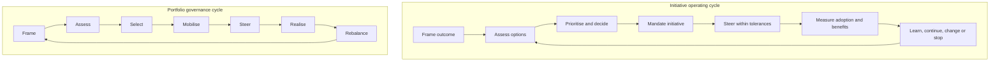

# Technology Strategy, Execution & Governance

**A connected set of executive frameworks and practical governance tools for turning technology strategy into investment choices, governed execution and measurable outcomes.**

**Developed and maintained by Alexandro Sances.**

Technology decisions rarely stand in isolation. Strategy, architecture, investment, delivery, risk, ecosystems, digital assets, infrastructure and operational ownership interact, while choices made in one area often create dependencies somewhere else.

This repository brings those dimensions together around a simple idea: start from the outcome that matters, understand the capabilities, assets and dependencies required, compare realistic options, make investment and accountability explicit, and then govern delivery and lifecycle choices through evidence.

The approach is deliberately technology-neutral. Open source, enterprise AI, digital infrastructure and other technology domains have different characteristics and risks, but they can be governed through a common logic without forcing them into identical models.

## How the repository is organised

The repository has two complementary parts.

### [Frameworks](frameworks/README.md)

The **frameworks** provide the strategic and governance model.

They start from a common foundation for connecting strategy, technology choices, investment, execution and outcomes. That foundation is then translated into executive operating practice, portfolio governance and domain-specific frameworks addressing open source, enterprise AI and RAG, and digital infrastructure and sustainability.

The objective is not to create separate governance systems for each technology domain. It is to use a common management approach while adding the specialist evidence and controls that each domain actually requires.

### [Templates](templates/README.md)

The **templates** translate the frameworks into reusable working artefacts.

They support a practical sequence for framing an initiative, comparing alternatives, documenting decisions, assigning accountability, defining measures and validating benefits.

They are designed to keep governance connected to real decisions rather than becoming an additional reporting layer.

## The governance model

Across the repository, the underlying logic is:

**Strategic outcomes → Capabilities → Technology choices → Investment → Governed execution → Adoption → Measurable outcomes**

At initiative level, the operating cycle is:

**Frame outcome → Assess options → Prioritise and decide → Mandate initiative → Steer within tolerances → Measure adoption and benefits → Learn, continue, change or stop**

At portfolio level, a distinct governance cycle applies:

**Frame → Assess → Select → Mobilise → Steer → Realise → Rebalance**

The initiative cycle governs an individual change from framing through evidence-led learning. The portfolio cycle governs the composition and balance of the overall investment portfolio; it does not replace or rename the initiative lifecycle.

## Common governance lenses

Different technology choices create different specialist questions, but a number of management concerns recur across almost all of them.

The frameworks therefore consider strategy and user outcomes alongside digital assets, provenance, supply-chain transparency, investment, architecture, interoperability, accessibility, security, procurement, lifecycle economics, ecosystem and supplier dependencies, sustainability, portability and exit.

These should not become independent approval layers. They are different lenses through which a material technology decision can be understood.

The more critical, expensive, difficult to reverse or strategically dependent a choice becomes, the stronger the evidence and governance should normally be.

## Strategic technology domains

Three domains are currently developed in greater depth.

**Open Source Strategy & Governance** looks beyond licence and source availability to ecosystem and governance health, strategic dependencies, reuse, supply-chain transparency, contribution, shared stewardship, procurement and credible continuity or exit options.

**Enterprise AI & RAG Governance** connects AI use cases with information readiness, provenance, architecture, access control, model and provider dependencies, evaluation, human oversight, accessibility and lifecycle governance.

**Digital Sustainability and Data Centre Energy Governance** connects digital service demand with infrastructure capacity, energy, water, resilience, lifecycle economics and useful service outcomes.

These are not intended as separate practices. They show how the same technology-governance principles can be applied to materially different domains.

## How to use the repository

If the starting point is a strategic technology question, begin with [**Technology Strategy & Execution Governance**](frameworks/technology-strategy-execution-governance.md).

If the challenge is translating strategy into decisions, accountability and delivery, continue with the [**Strategy & Execution Governance — Executive Playbook**](frameworks/strategy-execution-governance-playbook.md).

If the question concerns investment balance, shared digital assets, competing initiatives, scarce capacity or sequencing, use [**Digital Portfolio Governance**](frameworks/digital-portfolio-governance.md).

Then apply the relevant domain framework:

- [**Open Source Strategy & Governance**](frameworks/open-source-strategy-governance.md)
- [**Enterprise AI & RAG Governance Blueprint**](frameworks/enterprise-ai-rag-governance-blueprint.md)
- [**Digital Sustainability and Data Centre Energy Governance**](frameworks/digital-sustainability-data-centre-governance.md)

The [**Executive Governance Templates**](templates/README.md) provide reusable working artefacts for applying the playbook method, including the RACI matrix, KPI dictionary and reference, benefit profile, initiative canvas, weighted scoring matrix, decision records, governance forum charters, escalation and status, strategic dependency register, open-source and AI/RAG assessments, infrastructure capacity decision and executive checklists.

## Principles

A number of principles run consistently through the material:

- start from outcomes and user or service needs rather than technology preferences;
- keep strategy, investment, architecture and execution connected;
- make decision rights and accountability explicit;
- apply governance in proportion to criticality, scale and reversibility;
- make assets and dependencies visible rather than assuming that a particular technology or sourcing model removes them;
- consider provenance, interoperability, accessibility, portability and exit while choices are still reversible;
- evaluate lifecycle economics rather than acquisition cost alone;
- distinguish technical openness from practical control;
- distinguish delivery from adoption and adoption from realised value;
- use evidence to learn, rebalance and, where necessary, stop.

The intention is not to eliminate uncertainty. It is to make uncertainty, assumptions and trade-offs sufficiently visible for better decisions to be made.

## About the author

**Alexandro Sances** works on technology strategy, digital transformation and governance, with a particular interest in connecting strategic technology choices with organisational governance and practical execution.

His areas of professional focus include **technology strategy and execution, open source and digital ecosystems, enterprise AI and emerging technologies, digital infrastructure and sustainability, interoperability, digital platforms, and the governance of technology investments and dependencies**.

The frameworks and practical tools in this repository reflect that perspective. They explore not only which technologies can create value, but also how choices can be translated into execution, how assets, dependencies and trade-offs can be made visible, how accountability can be established, and how outcomes can be measured over time.

The work continues to evolve through professional practice, research, advisory activities and engagement with technology strategy and governance.

## Professional Background

Alexandro Sances' experience includes **international executive, advisory, board and mentoring roles** across telecommunications, satellite communications, insurtech, connected mobility, telematics, IoT, data-driven services and digital platforms.

This cross-sector experience informs the perspective taken throughout the repository: technology is considered not in isolation, but in relation to strategy, people, organisational capabilities, ecosystems, execution and measurable outcomes.

## Contact

- [LinkedIn](https://www.linkedin.com/in/alexandrosances/)
- [Email](mailto:alexandro.sances@gmail.com)

## Scope and personal note

The frameworks, templates and other materials published in this repository are independently authored professional reference resources intended for adaptation.

They do not constitute legal, financial, security, procurement or regulatory advice.

The views, frameworks and materials published here are personal and do not necessarily represent the positions, policies or practices of any organisation with which I am, or have been, associated. No confidential, proprietary or non-public organisational information is intentionally included.

Worked examples, ratings, thresholds and scenarios identified as illustrative should not be interpreted as evidence of actual implementations, decisions or results.

**Author:** Alexandro Sances  
**Licence:** CC BY 4.0

---

*Connecting strategy, technology and people to turn complexity into measurable outcomes.*
