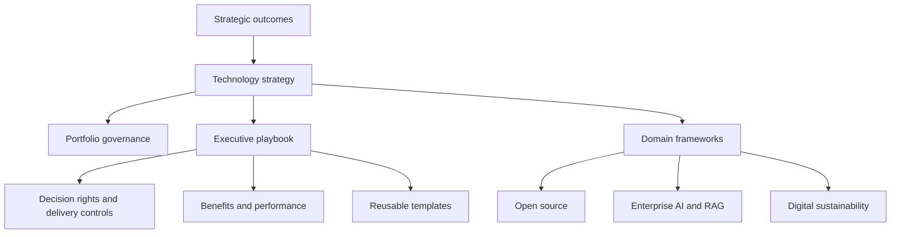

# Frameworks — Technology Strategy, Execution & Governance

**Connected executive frameworks for turning technology choices into investment decisions, governed execution and measurable outcomes.**

Technology decisions rarely sit in isolation. Strategy, architecture, investment, delivery, risk, ecosystems, sustainability and operational ownership interact, and choices made in one area often create dependencies in another. This repository brings those dimensions together in a single, technology-neutral governance approach.

The material is organised around a simple idea: start from the outcome that matters, understand the capabilities and dependencies required, compare realistic options, make investment and accountability explicit, and then govern delivery and lifecycle choices using evidence. The same logic can be applied to different technology domains without pretending that those domains have identical risks or operating models.

## How the repository is organised

### Core framework

[**Technology Strategy & Execution Governance**](technology-strategy-execution-governance.md) provides the overall logic. It connects strategic outcomes, capabilities, technology choices, investments, delivery, adoption and benefits. Use it to frame the questions leaders should ask before technology choices become projects or commitments.

### Turning strategy into operating practice

[**Strategy & Execution Governance — Executive Playbook**](strategy-execution-governance-playbook.md) describes the operating method for decision rights, prioritisation, initiative mandates, tolerance-based escalation and benefits governance. The associated RACI, KPI and decision-record templates are maintained separately in the [templates folder](../templates/README.md).

[**Digital Portfolio Governance**](digital-portfolio-governance.md) focuses on the portfolio level: deciding where limited funding and capability should be applied, sequencing initiatives, managing shared dependencies and rebalancing investment when evidence changes.

### Strategic technology domains

[**Open Source Strategy & Governance**](open-source-strategy-governance.md) applies the common governance logic to open-source adoption, strategic dependencies, ecosystem health, contribution, shared stewardship, procurement and credible exit or fork options.

[**Enterprise AI & RAG Governance Blueprint**](enterprise-ai-rag-governance-blueprint.md) applies it to enterprise AI and retrieval-augmented generation, with particular attention to information readiness, model and retrieval choices, access control, evaluation, human oversight and lifecycle governance.

[**Digital Sustainability and Data Centre Energy Governance**](digital-sustainability-data-centre-governance.md) applies it to digital infrastructure, connecting service demand with energy, water, emissions, capacity, resilience, procurement and useful service output.

## Operational templates

The playbook describes the method; the templates put it into practice. Reusable working artefacts are maintained separately in the [templates folder](../templates/README.md): [RACI](../templates/raci-matrix.md), [KPI dictionary](../templates/kpi-dictionary.md), [benefit profile](../templates/benefit-profile.md), [initiative canvas](../templates/initiative-canvas.md), [weighted scoring matrix](../templates/weighted-scoring-matrix.md) and [completed illustrative decision record](../templates/decision-record-example.md). The scoring example is fictional and its calculations are shown transparently.

Further working tools complement these: [governance forums](../templates/governance-forums.md), [escalation and status](../templates/escalation-and-status.md), [strategic dependency register](../templates/strategic-dependency-register.md), the [KPI reference](../templates/kpi-reference.md) for open-source, sustainability and AI/RAG measures, the [open-source assessment](../templates/open-source-assessment.md), the [AI/RAG use-case assessment](../templates/ai-rag-use-case-assessment.md), the [infrastructure capacity decision](../templates/infrastructure-capacity-decision.md) and the [executive checklists](../templates/executive-checklists.md).

## Framework relationships

## Common governance lenses

The frameworks are intentionally connected. Across different domains, the same management questions recur: What outcome are we trying to achieve? What evidence supports the need? Which dependencies are being created? Who decides and who remains accountable? How do architecture, interoperability, security and procurement affect future choices? What is the full lifecycle cost? What happens if assumptions change, a supplier or ecosystem becomes fragile, or an exit becomes necessary? How will value actually be measured?

These common lenses are not separate approval layers. They are a way to make trade-offs visible and to apply proportionate governance according to materiality, criticality and reversibility.

## A simple reading path

If you are starting from a strategic question, begin with **Technology Strategy & Execution Governance**. If you need to operationalise decisions, move to the **Executive Playbook**. If the issue is investment balance and sequencing, use **Digital Portfolio Governance**. Then use the relevant domain framework where the decision concerns open source, enterprise AI/RAG, or digital infrastructure and sustainability.

## Principles

The repository-wide principles are consolidated in the [root README](../README.md#principles) and apply across all frameworks. Domain frameworks add specialist evidence and controls without creating competing principle lists.

## Scope

These are independently authored professional reference materials. They are starting points for adaptation, not universal prescriptions. They do not constitute legal, financial, security, procurement or regulatory advice, and they do not represent the policies or practices of any employer or organisation. Illustrative examples are identified as such and should not be read as evidence of real implementations or results.

## Author and contact

Alexandro Sances, Senior Technology Executive, Rome, Italy.

- [LinkedIn](https://www.linkedin.com/in/alexandrosances/)
- [Email](mailto:alexandro.sances@gmail.com)