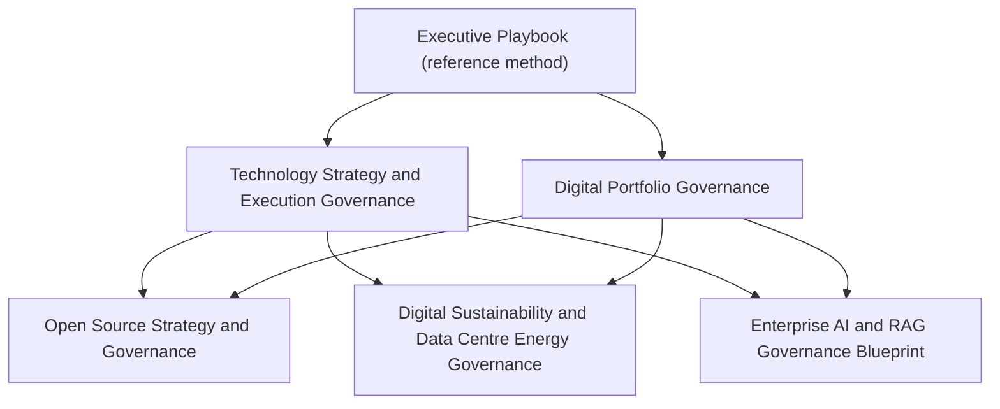

# Frameworks & Reference Models

Independent professional guidance for leaders connecting technology strategy, investment choices, governance and outcomes.

*Version 1.1 · Status: draft for review · Updated: November 2026 · Licence: to be confirmed*

## Start with the executive playbook

[**Strategy & Execution Governance — Executive Playbook**](strategy-execution-governance-playbook.md) is the practical entry point. It includes decision rights, prioritisation rules, a governance operating model, RACI, delivery controls, KPI definitions, benefits templates, checklists and a fictional worked example. For open-source strategy, ecosystem participation and stewardship, see the dedicated [Open Source Strategy & Governance](open-source-strategy-governance.md) framework. For energy and resource considerations in digital infrastructure, see [Digital Sustainability and Data Centre Energy Governance](digital-sustainability-data-centre-governance.md).

## Reference frameworks

| Framework | Use it to |
|---|---|
| [Technology Strategy & Execution Governance](technology-strategy-execution-governance.md) | Connect strategic outcomes to capabilities, investment, delivery and benefits. |
| [Digital Portfolio Governance](digital-portfolio-governance.md) | Make portfolio selection, sequencing, delivery confidence and rebalancing visible. |
| [Open Source Strategy & Governance](open-source-strategy-governance.md) | Govern open-source adoption, contribution, ecosystem relationships, risk and sustainability. |
| [Digital Sustainability and Data Centre Energy Governance](digital-sustainability-data-centre-governance.md) | Bring energy, water, emissions, infrastructure, procurement and service outcomes into digital investment decisions. |
| [Enterprise AI & RAG Governance Blueprint](enterprise-ai-rag-governance-blueprint.md) | Assess and govern enterprise AI/RAG use cases, information, controls and lifecycle. |

## How the frameworks fit together

The Executive Playbook is the reference method. The Technology Strategy and Digital Portfolio frameworks apply it at strategy and portfolio level; the thematic frameworks add topic-specific controls.

## How to use these materials

These documents are starting points, not universal prescriptions. Adapt them to organisational scale, regulatory context, operating model, risk appetite and delivery maturity. Guidance describes a proposed reference approach; illustrative examples and assumptions are identified as such and are not evidence of real implementation or results.

The frameworks aim to clarify:

- The questions leaders should ask and decisions they need to make.
- Roles, accountability and decision authority.
- Evidence required to govern progress and manage exceptions.
- Measures that show whether intended outcomes are being achieved.

## Principles

1. **Outcome before technology** — define the problem and intended value before selecting a solution.
2. **Proportionate governance** — apply controls appropriate to risk, complexity and scale.
3. **Clear accountability** — distinguish sponsorship, decision-making, delivery and assurance.
4. **Architecture with purpose** — guide choices without creating unnecessary bureaucracy.
5. **Evidence-based decisions** — make assumptions, dependencies, risks and performance visible.
6. **Continuous learning** — use delivery evidence and feedback to refine priorities and approaches.

## Scope

These are independently authored professional reference materials. They are not official standards, legal advice, procurement specifications or representations of any employer's policies. They do not describe confidential projects or imply implementation at a specific organisation.
