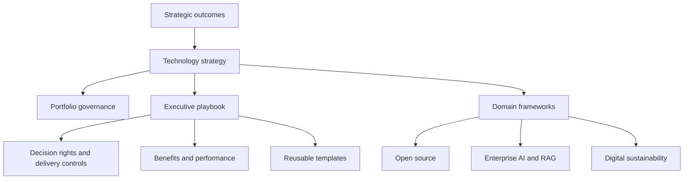

# Technology Strategy, Execution & Governance

**Connected executive frameworks for turning technology choices into investment decisions, governed execution and measurable outcomes.**

This repository connects strategy, architecture, investment, delivery, risk, ecosystems, sustainability and operational ownership through a technology-neutral governance approach.

## Frameworks

- [Technology Strategy & Execution Governance](technology-strategy-execution-governance.md) — the overall strategy-to-outcomes model.
- [Strategy & Execution Governance — Executive Playbook](strategy-execution-governance-playbook.md) — decision rights, prioritisation, RACI, escalation, KPIs and benefits.
- [Digital Portfolio Governance](digital-portfolio-governance.md) — investment balance, sequencing and rebalancing.
- [Open Source Strategy & Governance](open-source-strategy-governance.md) — adoption, dependencies, ecosystem health, contribution and stewardship.
- [Enterprise AI & RAG Governance Blueprint](enterprise-ai-rag-governance-blueprint.md) — information readiness, model and retrieval choices, access, evaluation and lifecycle governance.
- [Digital Sustainability and Data Centre Energy Governance](digital-sustainability-data-centre-governance.md) — service demand, energy, water, emissions, capacity and resilience.

## Operational templates

Frameworks describe the management logic; reusable working artefacts are maintained in the [templates folder](../templates/README.md):

- [RACI matrix](../templates/raci-matrix.md)
- [KPI dictionary](../templates/kpi-dictionary.md)
- [Benefit profile](../templates/benefit-profile.md)
- [Initiative canvas](../templates/initiative-canvas.md)
- [Weighted scoring matrix](../templates/weighted-scoring-matrix.md)
- [Completed illustrative decision record](../templates/decision-record-example.md)

The scoring example is fictional and its calculations are shown transparently. Mandatory obligations are separated from discretionary scoring.

## Framework relationships

## Principles

- Start from outcomes and user or service needs, not technology preferences.
- Keep strategy, investment, architecture and execution connected.
- Make decision rights and accountability explicit.
- Apply governance in proportion to risk, scale, criticality and reversibility.
- Prefer evidence to assumptions, while making uncertainty visible.
- Treat interoperability, portability and exit as strategic design concerns.
- Consider lifecycle economics rather than acquisition cost alone.
- Measure adoption and realised outcomes, not only delivery activity.

## Scope and metadata

These are independently authored professional reference materials, not universal prescriptions or legal, financial, security, procurement or regulatory advice. Illustrative examples are not evidence of real implementations or results.

- Version: 1.0.0
- Status: Reference edition
- Licence: [CC BY 4.0](../LICENSE)
- Last reviewed: 2026-11-12
