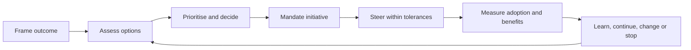

# Strategy & Execution Governance — Executive Playbook

**A practical, technology-neutral method for turning strategic intent into governed change.**

## 1. What this playbook is for

The playbook makes direction clear, decisions timely, ownership explicit and delivery evidence visible. A useful leadership sequence is **Frame → Specify outcomes → Compare options → Prioritise → Mandate → Steer → Realise → Learn**.

## 2. Decision rights and records

Executive leadership normally owns strategic direction and risk appetite; a portfolio authority allocates investment; sponsors mandate initiatives; design authorities manage material technical exceptions; delivery leaders correct execution within tolerance; and benefit owners validate outcomes.

For each material decision, record context and outcome, decision owner and date, realistic options including defer or do nothing, evidence and uncertainty, recommendation, cost/capacity/risk/dependency implications, dissenting views, conditions, action owners and review trigger. See the [completed decision record example](../templates/decision-record-example.md).

## 3. Prioritisation and investment

Separate legal, safety, resilience, contractual or time-critical obligations from discretionary choices. For discretionary investments, assess strategic contribution, user or service value, risk reduction, time to useful evidence, readiness, affordability and capacity.

Use the [weighted scoring matrix](../templates/weighted-scoring-matrix.md) to structure comparison. Numerical scores support discussion; they do not replace judgement, mandatory constraints or decision authority.

A one-page [initiative canvas](../templates/initiative-canvas.md) should capture the problem, outcome, baseline, options, value and confidence, lifecycle cost, dependencies, risks, owners and proposed decision.

## 4. Governance operating model

The minimum viable governance model needs only forums that can make a decision or resolve an impediment: strategic review, portfolio review, initiative review, design and assurance review, and benefits review. Each forum needs a remit, delegated authority, expected inputs, decision log and escalation path.

Use the [RACI matrix](../templates/raci-matrix.md) where it improves clarity, but do not treat it as a substitute for named ownership. Each initiative should have one accountable sponsor, a delivery owner, a service or product owner and a benefit owner.

## 5. Portfolio and delivery controls

Maintain a coherent view of approved outcome and scope, milestones and forecast, budget, dependencies, risks and assumptions, critical skills, adoption, service transition, assurance evidence, benefit baseline and decision history.

Set tolerances at mandate approval. Escalation should be triggered by forecast breach, not only after failure.

## 6. Measures and benefits

A compact KPI set is more useful than a large dashboard. Common measures include outcome attainment, milestone predictability, forecast variance, dependency health, adoption, benefit realisation, risk-action timeliness and decision lead time.

Use the [KPI dictionary](../templates/kpi-dictionary.md) to define measures consistently and the [benefit profile](../templates/benefit-profile.md) to record baseline, target, ownership, evidence and attribution. Separate what was delivered from what was adopted and what actually improved.

## 7. Domain application

The playbook supplies common governance mechanics. Domain frameworks add specialist evidence for open-source governance, AI/RAG information and evaluation, and infrastructure capacity and resource impacts. One initiative can use one investment and accountability model while drawing specialist controls from several domains.

## 8. Worked example

A fictional organisation with slow internal service-request resolution compares process clarification, targeted workflow tooling and broad platform replacement. A bounded process pilot is selected first because it offers faster evidence with less commitment. Technology investment remains conditional on baseline quality, adoption, integration needs and pilot evidence.

The related [scoring matrix](../templates/weighted-scoring-matrix.md) and [completed decision record](../templates/decision-record-example.md) provide the fictional worked example. Ratings are assumptions, not real achievements.

## 9. Executive checklist

Before investment, confirm problem, user, outcome, baseline and owner; realistic alternatives; separation of obligations from choices; lifecycle cost, capacity and dependencies; authority and review triggers.

Before delivery authorisation, confirm scope, acceptance evidence and tolerances; named owners; credible plan and skills; proportionate assurance; and adoption, support and benefit measurement.

At each review, distinguish actuals from forecasts, surface decisions, escalate forecast tolerance breaches and use adoption and outcome evidence to determine the next action.

## 10. Governance flow

## 11. Boundaries

This playbook is independent professional guidance, not an official standard, legal or financial advice, or procurement specification. Cadences, thresholds, scoring weights and role patterns must be adapted to context.

---

**Version:** 1.0.0 | **Status:** Reference edition | **Licence:** CC BY 4.0 | **Last reviewed:** 2026-11-12
