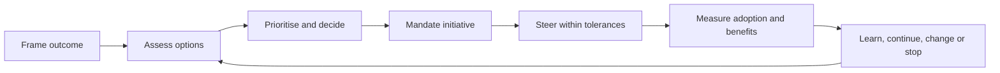

# Strategy & Execution Governance — Executive Playbook

**A practical, technology-neutral method for turning strategic intent into governed change.**

## 1. What this playbook is for

The core framework explains how strategy, technology and outcomes connect. This playbook focuses on the operating practice needed to make that connection real. Its purpose is to make direction clear, decisions timely, ownership explicit and delivery evidence visible without moving specialist judgement away from the teams that hold it.

The initiative operating cycle is: **Frame outcome → Assess options → Prioritise and decide → Mandate initiative → Steer within tolerances → Measure adoption and benefits → Learn, continue, change or stop**. The order matters. A solution should not receive delivery authority before the problem, expected outcome, key assumptions and accountable owners are understood.

## 2. Decision rights

Decision classes should have named authority. The **Executive sponsor** owns strategic direction and risk appetite; the **Portfolio authority** allocates investment within delegated limits; the **Executive sponsor** mandates initiatives; the **Architecture / assurance authority** manages material technical exceptions; the **Initiative lead** manages execution within tolerance; and the **Benefit owner** validates outcomes.

When authority is unclear, the answer is not another status meeting. The decision should be reframed with options, evidence, a recommendation, the latest safe decision date and the person who has authority to decide.

### Decision record

For each material decision, record:

- context and intended outcome;
- decision owner and required-by date;
- realistic options, including defer or do nothing where relevant;
- evidence, assumptions and uncertainty;
- recommendation and rationale;
- cost, capacity, risk and dependency implications;
- dissenting or unresolved views;
- decision, conditions, action owners and review trigger.

This record should be concise enough to use routinely and complete enough to explain later why the choice was made.

## 3. Prioritisation and investment

First separate obligations from choices. Legal, safety, resilience, contractual or time-critical obligations still consume scarce capacity, but they should not be disguised as discretionary initiatives with artificially high scores.

For discretionary investments, use the common criteria in the [weighted scoring matrix](../templates/weighted-scoring-matrix.md): outcome contribution (strategic, user or service value), feasibility and readiness, time to useful evidence, lifecycle cost and affordability, risk and dependency profile, and reversibility. Consider capacity explicitly when judging feasibility and affordability. Record the evidence and confidence behind each rating; the score informs judgement but does not replace it. High expected value with low confidence is usually a case for discovery or a bounded pilot, not immediate scale investment.

A one-page [initiative canvas](../templates/initiative-canvas.md) should capture the problem, strategic outcome, baseline and target, options considered, expected value and confidence, mandatory obligations, lifecycle cost, dependencies, principal risks, accountable owners and the proposed decision.

## 4. Governance operating model

The minimum viable governance model normally needs only the forums that can make a decision or resolve an impediment. Strategic review confirms outcomes and direction. Portfolio review balances investment and capacity. Initiative review addresses delivery within mandate. Design and assurance review deals with material architecture, security, privacy, resilience and operational questions. Benefits review examines adoption and outcome evidence after delivery.

Every forum should have a remit, delegated authority, expected inputs, decision log and escalation path. Cadence should follow the decision need rather than an arbitrary calendar.

### Accountability pattern

Use the [RACI template](../templates/raci-matrix.md) where it improves clarity, but avoid treating it as a substitute for named ownership. Use consistent role names throughout the repository: **Executive sponsor**, **Portfolio authority**, **Initiative lead**, **Service owner**, **Architecture / assurance authority**, and **Benefit owner**. Each initiative should have one named accountable owner for each relevant responsibility. Specialist assurance functions provide evidence and challenge; they do not silently inherit business accountability.

Forum charter and decision-class template: [governance forums](../templates/governance-forums.md).

## 5. Portfolio and delivery controls

Every material initiative should maintain a coherent view of approved outcome and scope, milestones and forecast, budget and estimate to complete, dependencies, risks and assumptions, critical skills, adoption, service transition, architecture and assurance evidence, benefit baseline and decision history.

Set tolerances at mandate approval. Escalation should be triggered by forecast breach, not only after failure has occurred. Typical triggers include a key milestone or cost forecast outside tolerance, a critical dependency without a credible recovery path, material change to outcome or risk, unavailable operational ownership, or benefit assumptions that no longer remain credible.

Status should distinguish actual progress, forecast, confidence, top risks, decisions required and outcome evidence. A traffic-light colour can summarise a defined rule but should never replace the explanation.

Tolerance sheet, escalation brief and status templates: [escalation and status](../templates/escalation-and-status.md).

## 6. Measures and benefits

A compact KPI set is more useful than a large dashboard. Common measures include outcome attainment, milestone predictability, forecast variance, critical-dependency health, adoption, benefit realisation, risk-action timeliness and decision lead time.

Use the [KPI dictionary](../templates/kpi-dictionary.md) and [benefit profile](../templates/benefit-profile.md) templates. For each benefit, define the baseline, target, unit, date, measurement source, accountable owner, dependencies, disbenefits and attribution assumptions. Separate what was delivered from what was adopted and what actually improved.

## 7. Applying the playbook to strategic technology domains

The playbook supplies the common governance mechanics. Domain frameworks add the evidence appropriate to the technology choice.

For open-source-dependent initiatives, add project and governance health, strategic dependency classification, supply-chain and licence evidence, participation mode, maintenance ownership and continuity options. For enterprise AI/RAG, add source governance, access model, evaluation evidence, model and retrieval changes, human oversight and incident paths. For digital infrastructure, add capacity forecasts, energy and water assumptions, resilience, service-output measures and infrastructure exit considerations.

This avoids creating multiple parallel governance systems. One initiative can be governed through the same investment, accountability and benefits process while drawing specialist controls from more than one domain.

The [weighted scoring matrix](../templates/weighted-scoring-matrix.md) provides a worked scoring example. Use the blank [decision record template](../templates/decision-record.md) to document a live decision; the [completed decision record](../templates/decision-record-example.md) is a separate fictional illustration. The playbook describes the method; the templates put it into practice.

Domain tools: [open-source assessment](../templates/open-source-assessment.md), [AI/RAG use-case assessment](../templates/ai-rag-use-case-assessment.md), [infrastructure capacity decision](../templates/infrastructure-capacity-decision.md) and [strategic dependency register](../templates/strategic-dependency-register.md).

## 8. Worked example: bounded service-improvement decision

Consider a fictional organisation with slow internal service-request resolution. Rather than starting with a platform procurement, leadership compares process clarification, targeted workflow tooling and an immediate broad platform replacement. The process option is used first as a bounded pilot because it provides faster evidence with less commitment. Technology investment remains conditional on baseline quality, adoption, integration needs and evidence from the pilot.

The example illustrates a wider principle: sequence commitments so uncertainty is reduced before irreversible cost increases. The **Executive sponsor** owns the intended outcome; the **Initiative lead** coordinates change; the **Service owner** owns adoption; the **Benefit owner** validates the measure; and the **Portfolio authority** decides whether evidence justifies further investment.

Figures, thresholds and outcomes in such worked examples should always be treated as assumptions until measured.

## 9. Executive checklist

Before an investment decision, confirm that the problem, user, outcome, baseline and accountable owner are explicit; realistic alternatives have been considered; obligations are separated from choices; lifecycle cost, capacity and dependencies are visible; and authority and review triggers are clear.

Before delivery authorisation, confirm that scope, acceptance evidence and tolerances are agreed; owners are named; the integrated plan and skills are credible; specialist assurance is proportionate; and adoption, support and benefit measurement are planned.

At each review, distinguish actuals from forecasts, surface decisions instead of hiding them in status, escalate forecast tolerance breaches and use adoption and outcome evidence to determine the next action.

Copyable versions of these checklists: [executive checklists](../templates/executive-checklists.md).

## 10. Governance flow

## 11. Boundaries

This playbook is independent professional guidance. It is not an official standard, legal or financial advice, or a procurement specification. Cadences, thresholds, scoring weights and role patterns must be adapted to context rather than copied mechanically.
