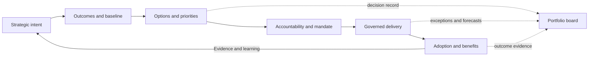

# Strategy & Execution Governance — Executive Playbook

**A practical, technology-neutral method for turning strategic intent into governed change, including open-source adoption and ecosystem stewardship.**

> **How to read this document.** Sections labelled **Guidance** propose reusable practices. The case in Section 8 is **Illustrative only**: every organisation, figure, threshold, role assignment and result in it is invented to demonstrate use. It is not a claim of implementation experience or an observed result.

## 1. The leadership method

The leadership contribution is to make direction clear, decisions timely, ownership explicit and delivery evidence visible—while enabling qualified teams to design and deliver change. For open-source-dependent work, this also means setting a responsible adoption and participation model, with technical implementation and community contributions owned by the people who perform them.

**Guidance — working sequence**

1. **Frame:** describe the problem, affected users, strategic outcome and constraints.
2. **Specify outcomes:** baseline, target, date, measure and accountable benefit owner.
3. **Compare options:** include process redesign, reuse, buy, build, partner, defer and do nothing where relevant.
4. **Prioritise:** show value, urgency, confidence, capacity, risk and dependencies; make trade-offs explicit.
5. **Mandate:** name sponsor, delivery owner, benefit owner, decision authority and tolerances.
6. **Steer:** review evidence and forecast, resolve cross-team constraints, and escalate exceptions.
7. **Realise:** verify adoption and outcomes after delivery; continue, adapt or stop based on evidence.

The executive role is to set direction and guardrails, make or delegate decisions, align stakeholders, secure capacity, challenge evidence and remove systemic barriers. Specialist teams retain accountability for professional design, implementation, testing and operations.

## 2. Decision framework

### 2.1 Decision classes and authority

| Decision class | Examples | Accountable decision-maker | Required input |
|---|---|---|---|
| Strategic direction | Outcomes, principles, risk appetite | Executive leadership | Strategy, finance, risk and affected business leaders |
| Portfolio allocation | Start, stop, defer, accelerate; funding envelope | Portfolio board within delegated authority | Portfolio lead, sponsors, finance, capacity owners |
| Initiative mandate | Scope, outcome, owner, tolerances | Executive sponsor | Product/service owner, delivery lead, architecture and assurance |
| Material design exception | Deviation from agreed principles or material risk | Named design authority or delegated executive | Architecture, security, operations, delivery |
| Delivery correction | Recovery actions within approved scope and tolerance | Delivery/initiative lead | Team evidence and impacted owners |
| Benefit acceptance | Confirm outcome evidence and next action | Benefit owner; sponsor accountable for response | Service data, finance and users |

**Guidance:** publish monetary and schedule limits, risk thresholds, and matters reserved for senior decision. If authority is unclear or a tolerance is forecast to be breached, escalate with options and a recommendation. Do not present an unresolved decision as a status update.

### 2.2 Decision record template

Copy for each material decision:

| Field | Entry |
|---|---|
| Decision ID / date | |
| Decision required by | |
| Decision owner | |
| Context and intended outcome | |
| Options considered, including defer / do nothing | |
| Evidence and assumptions | |
| Recommendation and rationale | |
| Cost, capacity, risk and dependency implications | |
| Dissenting view / unresolved uncertainty | |
| Decision and conditions | |
| Accountable action owner and due date | |
| Review trigger / date | |

## 3. Prioritisation and investment

### 3.1 First separate obligations from choices

**Guidance:** identify legal, safety, contractual, resilience and time-critical obligations first. Confirm the source, deadline, consequence of delay and minimum compliant scope with the accountable specialist. Mandatory work still competes for capacity; expose its cost and what it displaces. Rank discretionary work in a separate, transparent comparison.

### 3.2 Scored comparison for discretionary initiatives

Rate each factor from 1 (low) to 5 (high), attach evidence and confidence, and calculate a discussion score:

| Factor | Weight | Rating question |
|---|---:|---|
| Strategic contribution | 25% | How directly does this advance an agreed outcome? |
| User / service value | 20% | How material is the expected improvement for users or operations? |
| Risk reduction / resilience | 15% | How much material risk is reduced? |
| Time to useful evidence | 10% | How soon can a meaningful outcome be tested? |
| Feasibility and readiness | 15% | Are skills, information, design and change readiness available? |
| Affordability and capacity fit | 15% | Can lifecycle cost and scarce capacity be accommodated? |

**Weighted score = sum of (rating ÷ 5 × weight).** The score ranges from 0 to 100. It is a screening aid, not an investment answer or a forecast of benefits. Record rating evidence and confidence (high / medium / low). A low-confidence high score should trigger discovery or a bounded experiment, not automatic approval.

Then apply the capacity and sequencing screen:

| Expected value | Readiness / confidence | Suggested treatment |
|---|---|---|
| High | High | Consider investment, subject to affordability and dependency fit |
| High | Low | Fund discovery, validation or a bounded pilot with an explicit exit decision |
| Low | High | Defer, reduce scope or proceed only for a stated enabling reason |
| Low | Low | Stop or hold pending new evidence |

**Decision rules:** no score overrides mandatory obligations, unacceptable risk, lack of accountable ownership or unavailable capacity. Compare initiatives as a portfolio: dependencies, shared teams, operational load and strategic balance can change the order. Record selected, deferred and rejected options and the reason.

### 3.3 One-page initiative canvas

- **Problem / affected users:**
- **Strategic outcome and measure:**
- **Baseline / target / date:**
- **Options considered (including process change and no change):**
- **Expected value and confidence:**
- **Mandatory obligation (if any) and source:**
- **Indicative lifecycle cost / funding / capacity:**
- **Key dependencies and assumptions:**
- **Principal risks and mitigations:**
- **Sponsor / delivery owner / benefit owner:**
- **Proposed decision, conditions and next review:**

## 4. Governance operating model

### 4.1 Minimum viable forums

| Forum | Cadence (illustrative) | Purpose and decisions | Core inputs | Outputs |
|---|---|---|---|---|
| Executive strategy review | Quarterly or on trigger | Confirm outcomes, direction, risk appetite and major trade-offs | Outcome trends, strategic changes, material exceptions | Direction, reserved decisions, mandate changes |
| Portfolio review | Monthly | Balance investment, capacity and dependencies; start/stop/defer/accelerate | Initiative canvases, forecasts, capacity, risks, benefit evidence | Prioritised portfolio, decisions, owners and dates |
| Initiative review | Fortnightly or monthly, proportionate to risk | Correct delivery within mandate; escalate tolerance breaches | Milestones, cost forecast, RAID, dependencies, quality/adoption | Actions, decisions, escalation requests |
| Design / assurance review | At material decisions and changes | Challenge architecture, security, privacy, resilience and operability | Options, impact, exceptions, specialist assessments | Approval, conditions, exception or escalation |
| Benefits review | At agreed post-change intervals | Validate adoption and outcome evidence; adapt or stop | Baseline, actuals, attribution limits, user feedback | Benefit action, owner, next measurement |

Cadence is a starting point, not a prescribed standard. A forum should meet only when it can make decisions or resolve impediments. Publish its remit, chair, attendees, delegated authority, quorum, inputs and decision log.

### 4.2 RACI and accountability

R = does the work; A = one role answerable for the result; C = consulted; I = informed.

| Activity | Executive sponsor | Portfolio board | Portfolio lead | Delivery lead | Product / service owner | Benefit owner | Specialist assurance |
|---|---|---|---|---|---|---|---|
| Set strategic outcomes and guardrails | A | C | C | I | C | C | C |
| Assess and recommend portfolio order | C | A | R | C | C | C | C |
| Approve initiative mandate | A | C | R | C | C | C | C |
| Deliver within approved mandate | I | I | C | A/R | C | I | C |
| Prioritise product scope and adoption | C | I | I | C | A/R | C | C |
| Define and measure benefit | C | I | C | C | R | A | C |
| Assure material risks / exceptions | A* | C | I | R | C | I | R |
| Rebalance / stop / materially reset | C | A | R | C | C | C | C |

**Accountability notes:** assign one named individual to each A role for each initiative. The table is a reference pattern; adapt it to local delegations. *The accountable authority for a particular assurance decision must be explicitly designated; independent assurance advises and challenges but does not silently assume business ownership.*

## 5. Portfolio and delivery controls

### 5.1 Common control set

Every material initiative should have:

- An approved outcome, scope boundary, sponsor and benefit owner.
- A milestone plan with baseline, current forecast and changes explained.
- Budget, actual spend, estimate to complete and confidence range.
- Named dependencies, required-by dates and owning parties.
- Risks, assumptions, issues and decisions (RAID), each with owner and next action.
- Capacity and critical skills view across shared teams.
- Change, adoption, service transition and operational ownership plan.
- Proportionate architecture, security, privacy, resilience and quality evidence.
- Benefit baseline, target, data source and post-change review date.
- Decision and change log, including stop / defer / reset rationale.

### 5.2 Tolerance-based escalation

Set tolerances at mandate approval. A usable default pattern (to be tailored) is to escalate when a forecast—not only an actual—shows:

- A key milestone will exceed its approved tolerance.
- Cost at completion will exceed the delegated funding envelope.
- A critical dependency has no credible owner or recovery date.
- A material scope change affects the intended outcome or risk.
- Security, privacy, safety, regulatory or service exposure exceeds accepted appetite.
- Required capacity, adoption or operational ownership is unavailable.
- Benefit assumptions are no longer credible.

**Escalation brief:** exception; evidence and forecast; impact if unresolved; options and trade-offs; recommended decision; decision owner; latest safe decision date. The receiving authority records the decision and conditions.

### 5.3 Status discipline

Report separately: **actual progress**, **forecast**, **confidence**, **top risk / issue**, **decision needed**, **outcome evidence**. RAG colours may summarise a defined rule, but never replace these statements. A green label means within agreed tolerances with evidence; it does not mean “no issues”.

## 6. KPI dictionary and benefits realisation

Targets and thresholds must be set from the organisation’s baseline and context; the examples below define measures, not universal targets.

| Measure | Definition / calculation | Owner and source | Review / interpretation |
|---|---|---|---|
| Outcome attainment | Actual outcome value ÷ target value, with direction defined per measure | Benefit owner; agreed operational source | Monthly / quarterly; pair with baseline and attribution limits |
| Milestone predictability | Milestones achieved within approved tolerance ÷ milestones due in period | Delivery lead; baseline and forecast log | Monthly; segment by initiative type and do not hide rebaselines |
| Forecast variance | (Forecast cost at completion − approved budget) ÷ approved budget | Delivery lead with finance; financial forecast | Monthly; show absolute value and confidence range |
| Critical dependency health | Critical dependencies on track ÷ critical dependencies due or active | Portfolio lead; dependency log | Monthly; identify blocked items and owners |
| Adoption rate | Eligible intended users completing the defined target behaviour ÷ eligible intended users | Product/service owner; usage or process data | After launch at agreed intervals; use a meaningful behaviour, not logins alone |
| Benefit realisation | Verified benefit to date ÷ benefit planned to date, with valuation method stated | Benefit owner and finance; operational and finance sources | At benefits reviews; distinguish cash, capacity, quality and service effects |
| Risk action timeliness | High-priority actions completed by due date ÷ high-priority actions due | Risk owner; risk/action log | Monthly; overdue actions need explicit disposition |
| Decision lead time | Median calendar days from complete decision request to recorded decision | Governance chair / secretariat; decision log | Quarterly; segment by decision class and exclude incomplete submissions transparently |

### Benefits profile (copyable)

| Field | Entry |
|---|---|
| Benefit statement and category | |
| Baseline, date and source | |
| Target, unit and date | |
| Measurement method and frequency | |
| Benefit owner (one named person) | |
| Delivery and adoption assumptions | |
| Dependencies / external influences | |
| Disbenefits, costs or balancing measures | |
| Attribution method and confidence | |
| Actual result / evidence link | |
| Next review and action if off track | |

**Guidance:** separate output (what was delivered), adoption (what changed in use or process) and outcome (what improved). Benefits often depend on process redesign, behaviour and external conditions as well as technology. Record contribution and uncertainty; do not claim sole causation without evidence.

## 7. Executive checklists

### Before an investment decision
- [ ] Problem, user and strategic outcome are explicit.
- [ ] Baseline, target, date and benefit owner are stated.
- [ ] Viable options include process change, reuse and defer / do nothing.
- [ ] Mandatory status, evidence and deadline are verified.
- [ ] Scoring evidence, confidence, lifecycle cost and capacity are visible.
- [ ] Dependencies, material risks and assurance needs have owners.
- [ ] Decision authority, conditions and review trigger are clear.

### Before delivery authorisation
- [ ] Scope boundaries, acceptance evidence and tolerances are approved.
- [ ] Sponsor, delivery lead, service owner and benefit owner are named.
- [ ] Integrated plan, funding, skills and dependencies are credible.
- [ ] Security, privacy, architecture, quality and operational readiness are addressed proportionately.
- [ ] Adoption, communications, support and benefits measurement are planned.

### At each governance review
- [ ] Actuals are separated from forecasts and assumptions.
- [ ] Top risks and dependencies have owners and next actions.
- [ ] Tolerance breaches are escalated to the right authority.
- [ ] Decisions have options, recommendation, owner and due date.
- [ ] Capacity and portfolio trade-offs are considered.
- [ ] Adoption and outcome evidence informs the next action.

## 8. Open-source strategy and governance

Open source is both a way to consume software and a network of projects, maintainers, users and organisations. Digital infrastructure sustainability is also a strategic concern: energy, water and lifecycle impacts should be considered alongside service outcomes, resilience and cost. Treat it as a strategic operating choice, not simply a procurement label or a free substitute for a commercial product. Adoption, internal use, upstream contribution and community leadership are distinct participation modes; select and resource the mode intentionally.

Use the [Open Source Strategy & Governance framework](open-source-strategy-governance.md) for a detailed decision model, operating roles, risk controls, scorecard, participation ladder and fictional case. For data centre energy and broader digital sustainability, use the [Digital Sustainability and Data Centre Energy Governance framework](digital-sustainability-data-centre-governance.md), which includes investment gates, accountability, KPI definitions and a fictional case. Apply the same portfolio discipline in this playbook: establish the need and alternatives, assess total lifecycle cost and organisational capability, assign owners for legal/security/operations, and measure outcomes. Do not imply direct code contributions or maintainer responsibilities unless those activities are evidenced and specifically claimed.

## 9. Worked example — fictional service-request improvement

> **Illustrative assumptions only.** “Northstar Services”, its people, measures, costs, ratings, targets, timeline and all outcomes below are fictional. This example demonstrates a decision process; it is not evidence of a real programme or result.

### Situation and framing
A fictional organisation receives 12,000 internal service requests per month. Its assumed baseline median resolution time is 8 business days. Leaders want to improve staff experience and reduce avoidable rework. The baseline and counts are hypothetical and would need validation in a real decision.

### Options and portfolio decision
Three options are considered: (A) clarify process and ownership; (B) add workflow and knowledge tooling after process changes; (C) procure a broad service platform immediately. A fictional mandatory security update is treated separately as an obligation and reserved capacity before discretionary scoring.

| Option | Strategy 25 | User value 20 | Risk reduction 15 | Time to evidence 10 | Readiness 15 | Affordability 15 | Weighted |
|---|---:|---:|---:|---:|---:|---:|---:|
| A — process and ownership pilot | 4 | 4 | 2 | 5 | 5 | 5 | 81 |
| B — targeted workflow after pilot | 4 | 4 | 3 | 3 | 3 | 3 | 68 |
| C — broad platform now | 3 | 4 | 3 | 2 | 2 | 2 | 56 |

Scores are fictional discussion inputs, not measured facts. The board chooses A as a time-boxed discovery/pilot, reserves the separate mandatory capacity, and defers B and C until evidence on process adherence, data quality, integration needs and adoption is available. This is a staged option, not a claim that a tool or benefit has been delivered.

### Mandate and control
- **Sponsor:** fictional COO; owns the outcome and escalation.
- **Delivery lead:** fictional transformation lead; coordinates process, service and technology contributors.
- **Service owner:** fictional shared-services lead; owns workflow and adoption.
- **Benefit owner:** fictional operations manager; validates resolution-time and rework measures.
- **Decision authority:** fictional portfolio board approves pilot scope and any later investment.
- **Pilot guardrail:** no automated decision affecting employment or entitlements; human handling remains for exceptions. This is an example guardrail, not a universal policy.

### Illustrative measures and review
The hypothetical pilot would establish a validated baseline, then track median resolution time, rework rate (requests reopened or returned ÷ requests closed), adoption of the agreed intake process (eligible requests using it ÷ eligible requests), cost and staff feedback. A hypothetical target might be a 20% reduction in median resolution time within 90 days of the changed process becoming operational. This target is illustrative and should be reset after baseline validation. Review at 30/60/90 days; expand only if service quality does not worsen, adoption is credible and benefit evidence is acceptable. If the process change fails, stop or redesign before buying technology.

### Example decision record
**Decision:** approve a bounded process pilot and discovery; defer platform procurement.  
**Rationale:** faster evidence, lower initial commitment, and better information for any later design choice.  
**Conditions:** confirm data quality; preserve service continuity; assign operational owner; report weekly exceptions.  
**Revisit when:** 90-day evidence is available, a material risk emerges, or pilot cost/capacity tolerance is forecast to breach.  
**Evidence status:** all figures and results remain assumptions until measured.

## 10. Tailoring and boundaries

Apply governance in proportion to investment, complexity, risk and reversibility. A small reversible change may use a one-page canvas and delegated review; a critical enterprise change may need formal independent assurance and more frequent controls. Do not copy illustrative scoring weights, RACI assignments, cadences or thresholds without adapting them.

This playbook is independent professional guidance. It is not an official standard, legal or financial advice, a procurement specification, or an assertion that the author has implemented the example or achieved its illustrative outcomes. No employer-specific or confidential material is included.
