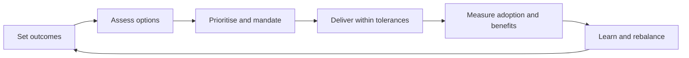

# Technology Strategy & Execution Governance Framework

**An executive reference framework for connecting strategic intent, technology choices and measurable delivery.**

## 1. Purpose

Technology strategy creates value only when strategic intent is translated into decisions, funded initiatives, accountable delivery and measurable outcomes.

This framework provides a practical management structure for connecting:

1. Business or organisational priorities.
2. Technology strategy and target capabilities.
3. Investment choices and a prioritised change portfolio.
4. Architecture, delivery and governance.
5. Performance measurement and benefits realisation.

It is intended for executive sponsors, technology leaders, transformation offices, portfolio managers and multidisciplinary delivery teams.

## 2. Strategy-to-execution logic

A useful operating chain is:

**Strategic outcomes → Required capabilities → Technology choices → Initiatives and investments → Governed delivery → Measured outcomes**

Each transition requires an explicit decision. A strategy should not move directly from aspiration to a list of projects without validating capabilities, dependencies, affordability, risks and organisational readiness.

### Core questions

| Stage | Questions |
|---|---|
| Strategic context | What problem or opportunity matters? Who benefits? |
| Outcomes | What should measurably change, and by when? |
| Capabilities | Which business, data, people and technology capabilities are required? |
| Options | What are the viable solution options, including process change and no-build options? |
| Investment | What value, cost, risk and opportunity cost are associated with each option? |
| Delivery | Who is accountable? What dependencies and constraints apply? |
| Benefits | How will adoption, outcomes and sustained value be verified? |

## 3. Strategic direction and principles

A technology strategy should establish a small number of explicit choices rather than attempt to prescribe every technical detail.

Recommended strategy components:

- A clear statement of organisational outcomes.
- A current-state assessment based on evidence.
- A target capability and architecture perspective.
- A set of technology and design principles.
- Strategic choices, constraints and areas of optionality.
- A prioritised roadmap with dependencies and decision points.
- An investment and sourcing perspective.
- Measures of progress and intended benefits.

### Example decision principles

1. Simplify and improve processes before automating them.
2. Prefer interoperability and open interfaces where appropriate.
3. Reuse proven capabilities when they meet requirements.
4. Design for security, privacy, resilience and accessibility from the outset.
5. Avoid unnecessary vendor or technology lock-in.
6. Make lifecycle cost and operational ownership visible.
7. Select technology according to the problem, not fashion.

These are proposed reference principles and should be tailored to the organisation.

## 4. Prioritisation and investment decisions

Prioritisation should combine strategic alignment with delivery feasibility and risk. A single numerical score can support discussion, but should not replace executive judgement.

### Suggested assessment dimensions

| Dimension | Assessment |
|---|---|
| Strategic alignment | Contribution to agreed strategic outcomes |
| User and service value | Expected improvement for users, customers or operators |
| Regulatory or operational necessity | Mandatory obligations or critical operational needs |
| Feasibility | Technical, organisational and delivery readiness |
| Cost and affordability | Total lifecycle cost and funding profile |
| Risk reduction | Security, resilience, compliance and operational risk |
| Dependencies | Prerequisites, shared platforms and sequencing |
| Time to value | How soon meaningful benefits can be demonstrated |

For each initiative, document the evidence, assumptions, confidence level and accountable decision-maker. Treat mandatory initiatives and discretionary investments transparently rather than forcing them into an artificial common ranking.

## 5. Governance model

Governance should make decisions faster and more reliable. It should not duplicate delivery management or create approval layers without a clear purpose.

### Illustrative accountability

| Role | Primary accountability |
|---|---|
| Executive sponsor | Strategic intent, sponsorship and outcome ownership |
| Strategy / portfolio board | Priorities, investment balance, major trade-offs and portfolio decisions |
| Technology leadership | Technology direction, architecture principles and technical coherence |
| Programme or initiative lead | Integrated plan, dependencies, risks, delivery coordination and reporting |
| Product / service owner | User needs, scope priorities, adoption and service outcomes |
| Delivery teams | Design, implementation, testing and operational readiness |
| Risk, security and assurance functions | Independent challenge and proportionate controls |

One person may hold more than one role in smaller organisations. The key is to make decision rights explicit.

### Governance forums

- **Strategic review:** validates outcomes, direction and major changes.
- **Portfolio review:** manages priorities, capacity, dependencies and investment trade-offs.
- **Architecture and design review:** addresses material design decisions, standards and exceptions.
- **Delivery review:** examines progress, forecast, risks, issues and decisions required.
- **Benefits review:** checks adoption and whether intended outcomes are being realised.

Each forum should have a defined remit, inputs, decision authority and recorded outcomes.

## 6. Delivery governance

Delivery governance should focus on transparency, early escalation and resolution of cross-team constraints.

A minimum integrated view should include:

- Scope, outcomes and acceptance criteria.
- Milestones and forecast dates.
- Budget, actuals and estimate to complete.
- Dependencies and critical path.
- Risks, assumptions, issues and decisions.
- Resource and capability constraints.
- Quality, security and operational readiness.
- Adoption and change-management activities.

Status reporting should distinguish facts, forecasts, assumptions and management judgement. Green status should not be used where material risks are merely being deferred or hidden.

## 7. Performance and benefits realisation

Measure both delivery performance and the outcomes enabled by delivery.

| Measurement layer | Example indicators |
|---|---|
| Strategic outcomes | Service quality, user satisfaction, productivity or mission outcomes |
| Portfolio | Strategic alignment, investment distribution, value at risk and portfolio balance |
| Delivery | Milestone predictability, lead time, forecast accuracy and unresolved dependencies |
| Technology | Availability, resilience, security posture, interoperability and technical debt |
| Adoption | Active use, process adoption, training and user feedback |
| Benefits | Cost avoidance, time saved, quality improvement and realised service value |

For every material benefit, define:

- A baseline and measurement method.
- A target and expected realisation date.
- An accountable benefit owner.
- Dependencies and assumptions.
- The source and frequency of measurement.

Do not attribute a benefit to a technology initiative without considering process, organisational and external factors.

## 8. Implementation roadmap

A proportionate adoption can proceed in four stages:

**Stage 1 — Understand**
- Confirm strategic outcomes and constraints.
- Assess current capabilities, portfolio and governance maturity.
- Identify major risks, dependencies and decision bottlenecks.

**Stage 2 — Design**
- Agree principles and target capabilities.
- Define decision rights and governance forums.
- Establish prioritisation and performance methods.

**Stage 3 — Apply**
- Pilot the framework on a representative set of initiatives.
- Introduce integrated portfolio and delivery reporting.
- Validate that governance improves decisions rather than adding overhead.

**Stage 4 — Improve**
- Review decision quality, delivery predictability and benefits.
- Remove redundant controls.
- Adjust the model as organisational maturity evolves.

## 9. Practical executive checklist

Before approving a significant technology initiative, confirm that:

- [ ] The problem and intended outcome are clear.
- [ ] The initiative is linked to strategic priorities.
- [ ] Options, including process change and reuse, have been considered.
- [ ] Costs, lifecycle implications and funding are understood.
- [ ] Architecture, security, privacy and operational implications are addressed.
- [ ] An accountable sponsor, delivery lead and benefit owner are identified.
- [ ] Dependencies, risks and assumptions are visible.
- [ ] Success measures and a benefits baseline are defined.
- [ ] The organisation has the capacity and capability to deliver and adopt the change.

## 10. Tailoring and limitations

This framework is a starting point for discussion and adaptation. It does not prescribe a specific delivery methodology, organisational structure, technology stack or regulatory interpretation. The governance model should be proportionate to the scale, complexity, criticality and risk of the initiative.

---

*Independent professional reference material. It is not an official standard, legal advice or a representation of any organisation's internal policies or practices.*

## 11. From framework to operating practice

Use the [Strategy & Execution Governance Executive Playbook](strategy-execution-governance-playbook.md) for the decision record, prioritisation method, governance cadence, RACI, tolerance-based escalation, KPI dictionary, benefits profile and fictional worked example.

A practical operating rhythm is:

At each transition, name the decision owner, evidence required and next review date. Record material assumptions separately from confirmed facts. The playbook's example and scoring weights are illustrative; calibrate all targets, thresholds and role assignments to the organisation.
