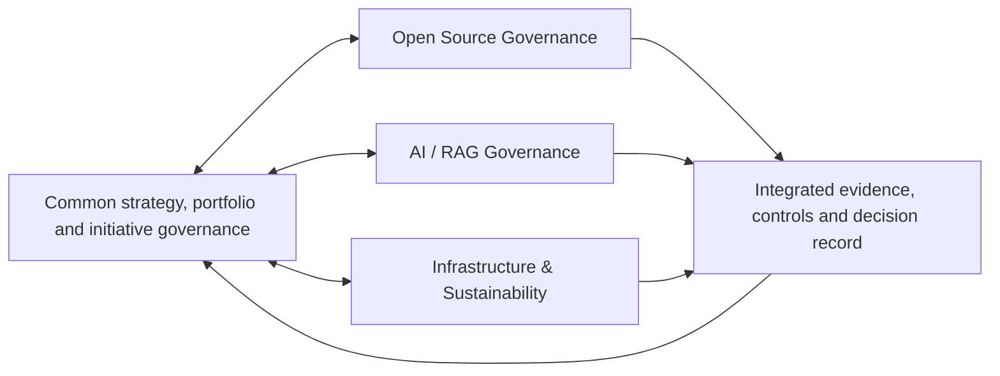

# Technology Strategy & Execution Governance Framework

**An executive reference framework for connecting strategic intent, technology choices, investment and measurable delivery.**

**Developed and maintained by Alexandro Sances.**

This technology strategy and execution governance framework explains how organisations translate strategic outcomes into capability choices, technology investments, accountable delivery and measurable benefits. It provides a common governance model that can be applied across enterprise technology domains.

> **In brief**
>
> - **What it is:** a technology-neutral model that connects strategic outcomes, capabilities, technology choices, investment, governed delivery and measured benefits.
> - **Operating chain:** Strategic outcomes → Required capabilities → Technology choices → Initiatives and investments → Governed delivery → Adoption → Measured outcomes.
> - **Use it when:** deciding whether and how to fund a significant technology initiative.
> - **Key test:** before approval, leadership can state the outcome being funded, why this option beats realistic alternatives, which dependencies and lifecycle obligations are accepted, who is accountable, and what evidence would cause it to continue, change course or stop.
> - **Not:** a delivery methodology, organisational structure, technology stack, procurement model or regulatory interpretation.

## 1. Purpose

Technology strategy creates value only when strategic intent can be translated into choices that an organisation is able to fund, deliver, operate and evaluate. A strategy that moves directly from ambition to a list of projects usually hides the most important questions: which capabilities are actually required, which dependencies will be created, what alternatives exist, who is accountable, and what evidence will show that the expected outcome has been achieved.

This framework provides the common structure used across the repository. It is deliberately technology-neutral. Open source, AI, cloud, data centres and other technology domains have different specialist concerns, but they benefit from the same discipline of connecting outcomes, capabilities, investment, governance and evidence.

A useful operating chain is:

**Strategic outcomes → Required capabilities → Technology choices → Initiatives and investments → Governed delivery → Adoption → Measured outcomes**

Each transition should represent an explicit decision rather than an automatic progression.

## 2. From strategic intent to technology choices

The starting point is the problem or opportunity, not the preferred technology. Leaders should be able to explain who benefits, what should change, how that change will be observed and which organisational capabilities are needed before evaluating products or architectures.

A sound strategy therefore combines a small number of explicit choices with enough room for specialist teams to design solutions. It should describe the current position, the target capabilities, the main architectural and sourcing principles, material constraints and dependencies, and the measures by which progress will be judged.

Useful questions include:

| Stage | Questions |
|---|---|
| Strategic context | What problem or opportunity matters, and for whom? |
| Outcomes | What should measurably change, by when and against which baseline? |
| Capabilities | Which business, people, data, operational and technology capabilities are required? |
| Options | Which process, reuse, buy, build, partner, open-source or managed-service options are realistic? |
| Dependencies | Which suppliers, ecosystems, standards, platforms, skills or infrastructures would become material? |
| Investment | What value, cost, capacity, risk and opportunity cost follow from each option? |
| Delivery | Who is accountable and what constraints or tolerances apply? |
| Lifecycle | How will the capability be operated, changed, supported and, if necessary, exited? |
| Benefits | How will adoption and sustained value be verified? |

## 3. Decision principles

Principles are useful when they help people make choices, not when they become slogans. A practical set might include simplifying a process before automating it, reusing proven capabilities when they genuinely fit, favouring interoperability and open interfaces where appropriate, designing security, privacy, resilience and accessibility from the outset, and making lifecycle cost and operational ownership visible.

Avoiding unnecessary lock-in should be understood broadly. Dependence may arise from a commercial supplier, a proprietary data model, an open-source project with concentrated governance, scarce specialist skills, an energy or infrastructure constraint, or an AI provider. The relevant question is therefore whether the dependency is visible, proportionate and manageable, and whether credible alternatives or exit paths exist.

**Technology sovereignty and strategic autonomy** describe the organisational ability to preserve credible options and decision-making power over technology choices and dependencies over time. This does not require technological self-sufficiency or the absence of external providers. It requires visibility of critical dependencies, meaningful alternatives, sufficient internal knowledge and practical exit readiness. These capabilities preserve option value and reduce the risk that today's technology choices constrain tomorrow's strategic decisions.

## 4. Investment and prioritisation

Prioritisation is a management judgement supported by evidence. A numerical score may help structure discussion, but cannot decide whether an initiative is mandatory, affordable, strategically coherent or deliverable with the available capacity.

Assess strategic alignment, user and service value, regulatory or operational necessity, feasibility, lifecycle cost, risk reduction, dependencies, time to useful evidence and reversibility. Record the evidence and confidence behind each judgement. Mandatory work should be visible as such rather than forced into the same scoring model as discretionary investment.

Portfolio-level methods, including sequencing and rebalancing, are developed in [Digital Portfolio Governance](digital-portfolio-governance.md). The [Strategy & Execution Governance — Executive Playbook](strategy-execution-governance-playbook.md) describes the operating method. Practical scoring, decision records and initiative tools are provided separately in the [templates folder](../templates/README.md).

## 5. Governance and decision rights

Governance should help qualified people make decisions at the right level and should make escalation easier when assumptions no longer hold. It should not duplicate delivery management.

Use consistent role names throughout the repository: **Executive sponsor**, **Portfolio authority**, **Initiative lead**, **Service owner**, **Architecture / assurance authority**, and **Benefit owner**. A typical model separates strategic direction, portfolio allocation, initiative sponsorship, technical design, delivery management, specialist assurance and benefits ownership. Smaller organisations may combine roles, but accountability should remain clear.

The important design question is not how many boards or committees exist. It is whether each material decision has an accountable owner, defined evidence, delegated authority and a review trigger. Executive strategy, portfolio, initiative, design / assurance and benefits reviews should exist only where they improve decision quality or resolve cross-cutting constraints.

## 6. Delivery and lifecycle governance

Delivery governance should make actual progress, forecast, uncertainty, dependencies and decisions visible. At minimum, material initiatives should maintain an integrated view of outcomes, milestones, budget, estimate to complete, dependencies, risks, assumptions, critical skills, operational readiness, adoption and benefits.

Lifecycle ownership starts before go-live. Technology choices should consider support, maintenance, supplier or ecosystem health, security response, skills, interoperability, portability and exit. Domain frameworks add specialist questions: governance health and stewardship for open-source dependencies, evaluation and information governance for AI/RAG, and capacity, energy and resource constraints for digital infrastructure.

## 7. Performance and benefits

Delivery output and realised outcome are not the same thing. Measure both.

A useful measurement model distinguishes strategic outcomes, portfolio health, delivery predictability, technology performance, adoption and benefits. Each material benefit should have a baseline, target, date, accountable owner, measurement source and explicit assumptions. Technology is seldom the sole cause of a benefit, so attribution should be treated carefully.

The operating rhythm is straightforward: define outcomes, assess options, prioritise and mandate, deliver within tolerances, measure adoption and benefits, and then learn and rebalance. The value of the cycle lies in the quality of the decisions, not the volume of reporting.

## 8. Applying the framework across strategic domains

The common model is intentionally reusable, but domain-specific governance still matters. The domain frameworks are **parallel specialist lenses, not sequential stages** in a prescribed lifecycle. An initiative may need one, several or none of them, depending on its technology choices, dependencies, risk profile and resource implications. Where more than one domain is material, their evidence and controls should be brought together within the same initiative governance and decision process.

For open source, the relevant questions include ecosystem and governance health, strategic dependency, contribution, shared stewardship, supply-chain visibility, procurement and credible fork or exit capability. See [Open Source Strategy & Governance](open-source-strategy-governance.md).

For enterprise AI and RAG, the focus moves to use-case suitability, information readiness, model and retrieval choices, access control, evaluation, human oversight and lifecycle changes. See [Enterprise AI & RAG Governance Blueprint](enterprise-ai-rag-governance-blueprint.md).

For data centres and digital infrastructure, service demand must be considered together with capacity, energy, water, emissions, resilience, procurement and useful output. See [Digital Sustainability and Data Centre Energy Governance](digital-sustainability-data-centre-governance.md).

These domains should not become separate governance silos. Where an initiative crosses them, use one investment and accountability model and add the specialist evidence needed for each material dependency.

## 9. Implementation

A proportionate implementation can begin by establishing strategic outcomes and decision rights, then applying the model to a small number of representative initiatives. The organisation can introduce portfolio and performance views once the underlying ownership and data are reliable. Controls that improve decisions should be retained; controls that merely create reporting overhead should be removed or simplified.

Before approving a significant initiative, leadership should be able to answer five questions in plain language: What outcome are we funding? Why is this option preferable to realistic alternatives? Which dependencies and lifecycle obligations are we accepting? Who is accountable for delivery, operation and benefits? What evidence will cause us to continue, change course or stop?

Working tools in the [templates folder](../templates/README.md): [initiative canvas](../templates/initiative-canvas.md), [weighted scoring matrix](../templates/weighted-scoring-matrix.md), [governance forums](../templates/governance-forums.md), [RACI matrix](../templates/raci-matrix.md) and [executive checklists](../templates/executive-checklists.md).

## 10. Boundaries

This framework is independent professional reference material. It does not prescribe a delivery methodology, organisational structure, technology stack, procurement model or regulatory interpretation. Apply it proportionately to scale, complexity, criticality and reversibility, and use qualified specialist advice where required.
