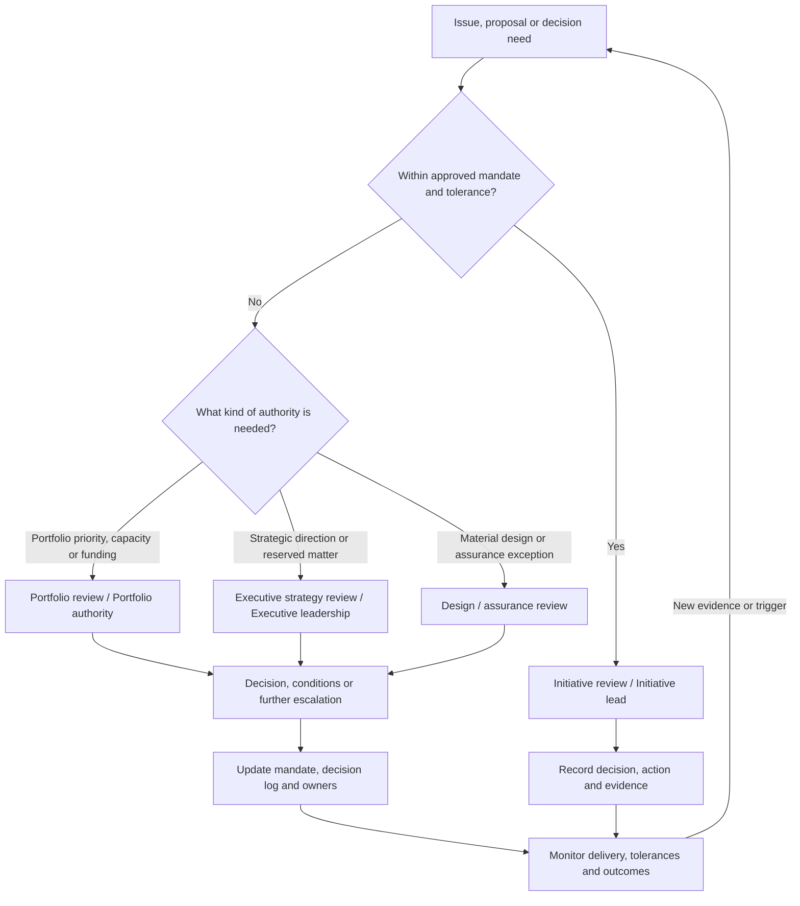

# Governance Forums — Template

**Version:** 1.1.0 | **Licence:** CC BY 4.0

Define only the forums that can make a decision or resolve an impediment, and give each a charter. Accountability by activity is covered in the [RACI matrix](raci-matrix.md).

Related: [Executive Playbook](../frameworks/strategy-execution-governance-playbook.md), Sections 2 and 4, and [Technology Strategy & Execution Governance](../frameworks/technology-strategy-execution-governance.md), Section 5.

## How decisions move through governance

The diagram shows a typical escalation and decision path. It is illustrative, not a mandatory hierarchy: delegated authority, materiality and the organisation's formal delegations determine the actual route. A decision should be taken at the lowest level with the authority and competence to make it; unresolved matters or matters outside tolerance move to the appropriate higher authority.

Benefits review validates adoption and outcome evidence at the agreed interval; it informs portfolio and executive decisions but does not replace the accountable Benefit owner.

## Decision classes and authority

| Decision class | Examples | Accountable decision-maker | Required input |
|---|---|---|---|
| Strategic direction | Outcomes, principles, risk appetite | Executive leadership | Strategy, finance, risk and affected business leaders |
| Portfolio allocation | Start, stop, defer, accelerate; funding envelope | Portfolio authority | Executive sponsor, Initiative leads, finance and capacity owners |
| Initiative mandate | Scope, outcome, owner, tolerances | Executive sponsor | Service owner, Initiative lead, architecture, assurance |
| Material design exception | Deviation from agreed principles or material risk | Architecture / assurance authority or delegated executive | Architecture, security, operations, delivery |
| Delivery correction | Recovery actions within approved scope and tolerance | Initiative lead | Team evidence and impacted owners |
| Benefit acceptance | Confirm outcome evidence and next action | Benefit owner; sponsor accountable for response | Service data, finance, users |

Publish monetary and schedule limits, risk thresholds and matters reserved for senior decision.

## Minimum viable forums

| Forum | Cadence (illustrative) | Purpose and decisions | Core inputs | Outputs |
|---|---|---|---|---|
| Executive strategy review | Quarterly or on trigger | Confirm outcomes, direction, risk appetite, major trade-offs | Outcome trends, strategic changes, material exceptions | Direction, reserved decisions, mandate changes |
| Portfolio review | Monthly | Balance investment, capacity and dependencies; start / stop / defer / accelerate | Initiative canvases, forecasts, capacity, risks, benefit evidence | Prioritised portfolio, decisions, owners and dates |
| Initiative review | Fortnightly or monthly, proportionate to risk | Correct delivery within mandate; escalate tolerance breaches | Milestones, cost forecast, RAID, dependencies, quality and adoption | Actions, decisions, escalation requests |
| Design / assurance review | At material decisions and changes | Challenge architecture, security, privacy, resilience, operability | Options, impact, exceptions, specialist assessments | Approval, conditions, exception or escalation |
| Benefits review | At agreed post-change intervals | Validate adoption and outcome evidence; adapt or stop | Baseline, actuals, attribution limits, user feedback | Benefit action, owner, next measurement |

Cadence follows the decision need, not a calendar.

## Forum charter template

Complete one charter for each forum. State decision rights precisely enough that participants can distinguish a decision the forum may take from a recommendation or matter that must be escalated. Adapt the fields to the organisation's scale; do not create a forum where a clear owner and a direct escalation route would suffice.

| Field | Entry |
|---|---|
| Forum name and purpose | |
| Remit and decisions it is authorised to make | |
| Delegated authority and limits (financial, scope, schedule, risk and other thresholds) | |
| Matters explicitly reserved for another authority | |
| Chair and deputy (if applicable) | |
| Membership, required roles and standing attendees | |
| Quorum and rules for a valid decision | |
| Standing inputs and who prepares them | |
| Expected outputs and action ownership | |
| Cadence and event-based convening triggers | |
| Decision log location and decision-log owner | |
| Escalation triggers (including tolerance breaches and unresolved conflicts) | |
| Escalation destination and latest safe decision date | |
| Charter owner | |
| Charter review date and effectiveness check | |

### Operating and review checks

Before approving the charter, confirm that:
- each decision type has one clearly identified accountable decision-maker;
- delegated limits and reserved matters are consistent with the organisation's wider delegations;
- quorum includes the roles needed to make the decisions within the forum's remit;
- papers arrive early enough to support evidence-based decisions;
- decisions, conditions, dissent, actions, owners and due dates are recorded;
- escalation identifies both the receiving authority and the latest safe decision date.

At the charter review, assess whether the forum is making the decisions it was established to make, within the required timescales, without duplicating another forum. Retire or redesign forums that do not add clear decision value.

For accountability by activity, use the [RACI matrix](raci-matrix.md). One person may hold several roles in a small organisation, but accountability for content, access, outcomes and operation should remain explicit.

*Template for adaptation. Independent professional reference material.*
